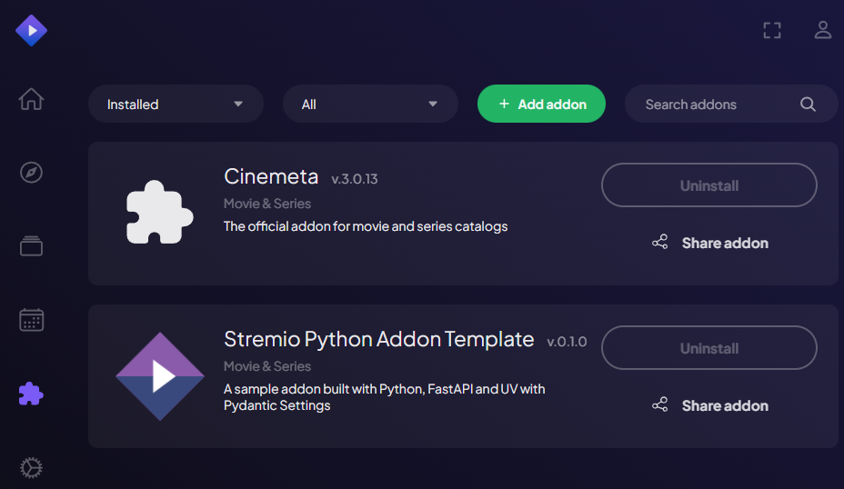

# Stremio Addon Python Template

[](https://www.stremio.com/)
[](https://www.python.org/downloads/)
[](https://github.com/astral-sh/ruff)
[](https://squidfunk.github.io/mkdocs-material/)
[](https://www.docker.com/)
[](https://github.com/features/actions)

A Stremio addon template in Python: a FastAPI server implementing the
[Stremio addon protocol](https://github.com/Stremio/stremio-addon-sdk/blob/master/docs/protocol.md),
with uv, Pydantic settings, loguru, pytest, Ruff, Git hooks, generated API docs and Conventional
Commit releases. Its tooling follows the
[Python Package Template](https://github.com/AmineDjeghri/python-package-template).

## Get started

With Make, Bash, Git and uv available:

```bash
git clone https://github.com/AmineDjeghri/stremio-addon-python-template.git
cd stremio-addon-python-template
make install-dev
make run
```

The addon listens on `http://127.0.0.1:7000` (`HOST` and `PORT` in `.env`). `make help` lists
all commands.

| URL                                  | Returns                                 |
|--------------------------------------|-----------------------------------------|
| `/`                                  | the manifest URL to install             |
| `/manifest.json`                     | addon capabilities                      |
| `/catalog/{type}/{id}.json`          | catalog items                           |
| `/stream/{type}/{id}.json`           | streams of one item                     |
| `/docs`                              | FastAPI API documentation               |

Replace the sample `MANIFEST`, `METAS` and `STREAMS` in `main.py` with your own source.

## Install it in Stremio

Stremio needs HTTPS. For a quick test, expose the server with a
[Cloudflare quick tunnel](https://developers.cloudflare.com/cloudflare-one/connections/connect-networks/do-more-with-tunnels/trycloudflare/):

```bash
cloudflared tunnel --url http://localhost:7000
```

1. Open `https://<random>.trycloudflare.com/manifest.json` in a browser to check it answers.
2. In Stremio, add that URL as an addon:

    

3. The catalog appears on the Board:

    

A quick tunnel gets a new URL at every start; use a named tunnel or your own domain for a stable one.

## Run in Docker

```bash
make docker-prod   # builds the image and serves the addon on port 7000 (PORT=8000 to change)
```

## Guides

| Task                                             | Guide                                                                                                                                        |
|--------------------------------------------------|----------------------------------------------------------------------------------------------------------------------------------------------|
| Install tools, configure an editor or use Docker | [Setup](docs/developer/1.setup.md)                                                                                                           |
| Add code or settings                             | [Project structure](docs/developer/2.project-structure.md)                                                                                   |
| Contribute a change                              | [Contributing](CONTRIBUTING.md) and [conventions](docs/developer/3.conventions.md)                                                           |
| Run tests and checks                             | [Testing](docs/developer/4.testing.md) and [test map](tests/README.md)                                                                       |
| Publish or retry a release                       | [Release](docs/developer/5.release.md)                                                                                                       |
| Start your own addon                             | [Use this template](https://github.com/AmineDjeghri/stremio-addon-python-template/generate) and [rename guide](docs/developer/6.template.md) |

Use `make deploy-doc-local` to preview the documentation.

Created by [Amine Djeghri](https://github.com/AmineDjeghri).
